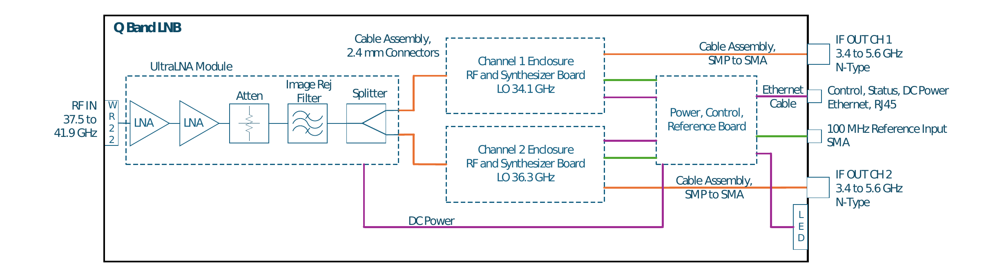
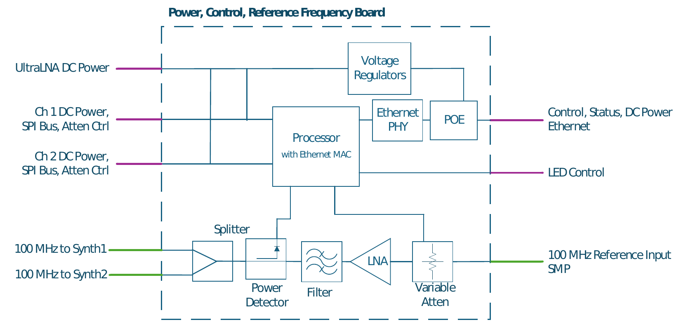

**Statement of Work**

**Union Embedded Software Development**

RFP number: AGMDC0011

**Project Overview and Objectives**

The Union Embedded Software Development Project consists of software
architecture, design, and implementation to support command and control
of a Low Noise Block (LNB) Downconverter for use in satellite
communications ground stations. The command and control interface to the
end customer is an Ethernet interface. The command and control interface
to internal components is SPI. There are a number of GPIO inputs and
outputs to/from the processor. There are a number of analog inputs to
the processor. There is a UART output for board level test.

The LNB block diagram is shown in Figure 1. The Processor board block
diagram is shown in Figure 2.

Figure 1 - LNB Block Diagram

Figure 2 - Processor Board

**Hardware and Target Environment**

The candidate processor is Infineon XMC7200-E272K8384AA. The candidate
Ethernet PHY is Texas Instruments DP83869HMRGZR. The candidate POE
controller is Analog Devices MAX5969A. Alternate processors can be
considered if all requirements defined in this document are met.

Requirement 1.1 specifies 1000 Base-T. 100 Base-T is also being
considered to simplify both hardware and software requirements. Vendors
are requested to provide a high level description of cost and schedule
differences for 1000 Base-T vs 100 Base-T.

**Scope of Work**

The scope of work includes:

- Development of embedded software architecture

- Definition of protocol for Ethernet command and control based on
  requirements in this document

- Embedded software design and implementation

- Embedded software documentation

  - Software functional description document

  - Interface control document for Ethernet interface command and
    control

- Test software design and implementation

- Embedded software test and requirements verification

- Support of AmpliTech engineers in hardware development. This includes
  schematic review of processor pin-out.

- Initial development will use manufacturer evaluation boards for
  components as needed

- The target application board(s) will be provided to the software
  developer as soon as possible, tentatively 10 weeks after the
  effective date of contract (EDC)

- Final test and requirements verification shall be completed using the
  target application board(s)

**References**

- IEEE 802.3-2018, IEEE Standard for Ethernet, 14 June 2018.

- IEEE 802.3at-2009, IEEE Standard for Information technology-- Local
  and metropolitan area networks-- Specific requirements-- Part 3:
  CSMA/CD Access Method and Physical Layer Specifications Amendment 3:
  Data Terminal Equipment (DTE) Power via the Media Dependent
  Interface (MDI) Enhancements, 11 September 2009.

- Open API Specification v3.1.1
  
- RFC 1305, Network Time Protocol (Version 3) Specification,
  Implementation and Analysis, March 1992.

- RFC 3413, Simple Network Management Protocol (SNMP) Applications,
  December 2002.

- RFC 3414, User-based Security Model (USM) for version 3 of the Simple
  Network Management Protocol (SNMPv3), December 2002.

- RFC 3415, View-based Access Control Model (VACM) for the Simple
  Network Management Protocol (SNMP), December 2002.

- RFC 3826, The Advanced Encryption Standard (AES) Cipher Algorithm in
  the SNMP User-based Security Model, June 2004.

- RFC 5424, The Syslog Protocol, March 2009.

- RFC 5905, Network Time Protocol Version 4: Protocol and Algorithms
  Specification, June 2010.

- RFC 7630, HMAC-SHA-2 Authentication Protocols in the User-based
  Security Model (USM) for SNMPv3, October 2015.

- Datasheet and additional reference documents, Infineon
  XMC7200-E272K8384AA Processor

  - <https://www.infineon.com/part/XMC7200D-E272K8384AA>

- Datasheet and additional reference documents, Texas Instruments
  DP83869HMRGZR Ethernet Phy

  - <https://www.ti.com/product/DP83869HM/part-details/DP83869HMRGZR>

- Datasheet, Analog Devices MAX5969A POE controller

  - <https://www.analog.com/en/products/max5969a.html>

- Datasheet, Analog Devices ADF4368 Synthesizer

  - <https://www.analog.com/en/products/adf4368.html>

- Datasheet, Analog Devices ADAR2001 Multiplier

  - <https://www.analog.com/en/products/adar2001.html>

- Datasheet, Analog Devices HMC425A Step Attenuator

  - <https://www.analog.com/en/products/hmc425a.html>

- Datasheet, Analog Devices ADL5906 Detector

  - <https://www.analog.com/en/products/adl5906.html>

- Datasheet, Analog Devices ADL5904 Detector

  - <https://www.analog.com/en/products/adl5904.html>

- Datasheet, Analog Devices HMC472A Step Attenuator

  - <https://www.analog.com/en/products/hmc472a.html>

- Datasheet, Microchip MCP9700A Temperature Sensor

  - <https://www.microchip.com/en-us/product/mcp9700a>

**Requirements**

1.  Ethernet Interface Requirements

    1.  Physical electrical interface: Single 1000 Base-T Ethernet
        interface. For clarity, all management and operator functions
        shall use a single common Ethernet interface.

    2.  Monitor and Control (M&C)

        1.  M&C protocol: The LNB shall implement M&C functions using
            either a RESTful or Simple Network Management Protocol
            (SNMP).

        2.  Restful: Sellers implementing a RESTful interface shall
            comply with the minimum specifications below.

            1.  Protocol: Restful protocols shall comply with Open API
                Specification v3.1.1.

            2.  Bearer: The RESTful bearer shall be HyperText Transfer
                Protocol Secure (HTTPS).

            3.  Transport security: HTTPs shall use Transport Security
                Layer (TLS) version 1.3.

            4.  Authentication: The RESTful M&C interface shall
                implement an authentication scheme approved by end
                customer.

            5.  Access control (authorization): The RESTful M&C
                interface shall utilize Role Based Access Control
                (RBAC).

            6.  RBAC: M&C roles may be predefined, or user defined with
                granular user management. End customer must approved the
                Seller role scheme.

        3.  SNMP: Sellers implementing SNMP shall only implement SNMP
            version 3 with the minimum specifications outlined in below.

            1.  M&C bearer: UDP over Ethernet.

            2.  SNMP USM: Implemented/Included.

            3.  SNMP USM Encryption: AES-128 Cipher Feedback Block
                (CFB).

            4.  SNMP USM Authentication: SHA-512.

            5.  SNMP VACM Implemented/Included.

            6.  SNMP VACM Groups: A minimum of 15 groups shall be
                supported.

    3.  M&C Reporting and Operations

        1.  M&C functions: The item shall include the operational M&C
            functions described below.

            1.  Summary alarm: Included.

                1.  See section 2.12 for alarm criteria

            2.  Over temperature alarm: Included.

                1.  See section 2.12 for alarm criteria

            3.  Communication fault: No requirement.

            4.  Critical internal temperatures: The LNB shall monitor
                and report via the M&C critical internal temperatures.

                1.  See section 2.10 for information on temperature
                    sensors

            5.  Set IP address: Included.

            6.  Set gain (attenuator): Included.

                1.  One attenuator on each RF board, up to 4 RF boards

                2.  Range of attenuator is 0 to 20 dB, increments of 1
                    dB

                3.  See section 2.6 for more information on attenuator
                    control

            7.  Read gain (attenuator): Included.

            8.  LNB Reboot: Included.

            9.  Alarm & warning reset: Included.

            10. Read all warnings: Included.

                1.  See section 2.11 for warning criteria

            11. Read all alarms: Included.

                1.  See section 2.12 for alarm criteria

            12. Read accumulated operating hours: Included. This
                function reports the number of unmuted operating hours.

            13. Read LNB model: Included.

                1.  To be set at test, see section 1.7

            14. Read LNB serial number: Included.

                1.  To be set at test, see section 1.7

            15. Read hardware LNB revision: Included.

                1.  To be set at test, see section 1.7

            16. Read LNB firmware version: Included.

                1.  To be set in source code

        2.  M&C Parametric values: The Item shall include capabilities
            to measure the internal parametric values described below
            and retrieve these values via the M&C interface.

            1.  Output IF signal power level: With a minimum range of
                -33 dBm to +12 dBm.

            2.  IF detector uncertainty (upper): ≤ 2.0 dB.

            3.  IF detector type: RMS.

            4.  Measurement rate: ≥ 4 measurements/second.

        3.  Factory Reset: The Item shall include a Factory Reset
            function implemented as detailed below

            1.  Factory reset interface: Internet Protocol over Ethernet
                with an aliased static IP address.

            2.  Factory reset interface security: The factory reset
                connection shall utilize TLS.

            3.  Factory reset interface limitations: Only a factory
                reset shall be possible over the factory reset
                interface.

            4.  Factory reset access: Only users with specific access
                privileges shall be able to execute a factory reset.
                Seller shall obtain end customer approval for the access
                privilege schema.

    4.  Event Recorder

        1.  Event record: The Item shall include an event recorder with
            the capabilities described below. An event recorder captures
            the state Item’s internal state in a continual logging
            operation and persists (semi-permanently logs) the state
            when the Item’s state changes.

            1.  Operator initiated changes: The Item shall log a state
                record prior to and following all Operator initiated
                changes.

            2.  M&C change: The Item shall log a state record prior to
                and after all M&C initiated changes.

            3.  Firmware update: The Item shall log a state record prior
                to and after all firmware updates.

            4.  Warnings, Alarms & Faults: The Item shall log a state
                record prior to and following all detected internal
                warnings, alarms, and faults.

            5.  Event recorder format: The Event Recorder log should
                follow RFC 5424.

            6.  Human readable: The Event Recorder log shall be human
                readable.

            7.  HMI access: The Event Recorder log shall be operator
                downloadable via the HMI.

            8.  Timestamps: All recorded events shall include a
                timestamp complying with ISO 8601-1 to the nearest
                millisecond.

    5.  Time

        1.  Item time: The Item shall incorporate time keeping (clock)
            capabilities described below

            1.  Time source: The Item shall obtain time via a network
                time server specified by the operator or external M&C
                master.

            2.  Time exchange protocol: Network Time Protocol.

            3.  NTP protocol version (objective): NTP version 4.

            4.  NTP protocol version (threshold): NTP version 3.

            5.  Time error: ≤ 1 second.

            6.  Time precision: ≤ 1 millisecond.

    6.  Firmware Update

        1.  Remote firmware & software updates: All Item firmware and
            software shall be remotely updateable via the Ethernet
            interface.

        2.  Firmware & software automation: The Item shall include a
            facility for the end user to remotely update firmware and
            software across their entire Item population. For clarity,
            this is intended as the ability to perform an unattended
            remote update.

        3.  Special firmware update tools: The Item shall not require
            special or Seller specific tools to conduct and manage
            firmware updates.

        4.  Firmware & software integrity: Firmware and software updates
            shall be authenticated during the update process using
            strong cryptographic methods such as SHA-2 or SHA-3 HASH
            functions or end customer approved digital signature
            methods.

        5.  Firmware & software update failure: In the event of a
            firmware or software update failure, the Item shall
            automatically roll back to the most recent functioning
            firmware and software version.

        6.  Firmware & software roll back: The end user shall be able to
            remotely roll back the firmware and software to prior
            versions.

    7.  Set at Test Variables

        1.  The following alphanumeric variables will be set at test by
            the operator using the Ethernet interface.

            1.  LNB Model Number

            2.  LNB Serial Number

            3.  Hardware LNB revision

        2.  Each variable is a maximum of 32 characters and shall be
            leading zero padded.

        3.  Dashes (-) are allowed.

2.  Internal LNB Requirements

    1.  Ethernet PHY Interface

        1.  The processor shall interface with the Ethernet PHY IC to
            meet all requirements in this document.

    2.  Status Pin GPIO Inputs from RF board(s)

        1.  One status signal from each RF board, up to 4 RF boards

        2.  Status signals are high for no faults; low indicates a fault

        3.  Weak pull up on each status pin so that status is high when
            RF boards are not connected

        4.  Status pin changes shall be reported to the UART output. See
            section 2.13 for more information on the UART
            requirements.

    3.  Status Pin GPIO inputs from on-board power regulators

        1.  One status signal from each LT80603, up to 12

            1.  Open drain output with pullup to 3.3 V

            2.  High for normal operation, low for fault state

        2.  One status signal from the POE controller, MAX5969A

            1.  Open drain output with pullup to 3.3 V

            2.  High for normal operation, low for fault state

        3.  Status pin changes shall be reported to the UART output. See
            section 2.13 for more information on the UART
            requirements.

    4.  LED control

        1.  Initializing state: Yellow LED

            1.  Enter this state on power up, and on reset. Hold this
                state until all input status pins are in “no fault”
                state.

            2.  Set GPIO output for Yellow LED high (3.3 VDC), must
                source up to 6 mA

            3.  Set GPIO outputs for Green LED and Red LED low (GND)

        2.  Normal Operating state: Green LED

            1.  Enter this state from Initializing state and from Fault
                state after all status input pins are in normal
                operating state

            2.  Set GPIO output for Green LED high (3.3 VDC), must
                source up to 6 mA

            3.  Set GPIO outputs for Yellow LED and Red LED low (GND)

        3.  Fault state: Red LED

            1.  Enter this state from normal operating state when any
                status input pin goes to fault state

            2.  Set GPIO output for Red LED high (3.3 VDC), must source
                up to 6 mA

            3.  Set GPIO outputs for Green LED and Yellow LED low (GND)

        4.  LED state changes shall be reported to the UART output. See
            section 2.13 for more information on the UART
            requirements.

    5.  SPI bus I/O

        1.  ADF4368 synthesizer register write and read

            1.  One ADF4368 synthesizer on each RF board, up to 4 RF
                boards

            2.  The registers shall be written and read on power up and
                after reset

            3.  The processor shall have the capability to write and
                read all registers defined in the ADF4368 data sheet.

            4.  The processor shall have the capability to write unique
                values into the ADF4368 registers for each unique RF
                board.

            5.  The register values shall be defined in the firmware and
                shall not be controllable through the Ethernet
                interface.

            6.  Register values to be used for this project for RF board
                1 and RF board 2 are defined in Appendix A.

            7.  When the registers are written and/or read a list of the
                registers and values shall be output on the UART
                interface. See section 2.13 for more information on
                the UART requirements.

        2.  ADAR2001 Multiplier register write and read

            1.  One ADAR2001 multiplier on each RF board, up to 4 RF
                boards

            2.  The registers shall be written and read on power up and
                after reset

            3.  The processor shall have the capability to write and
                read all registers defined in the ADAR2001 data sheet.

            4.  The processor shall have the capability to write unique
                values into the ADAR2001 registers for each unique RF
                board.

            5.  The register values shall be defined in the firmware and
                shall not be controllable through the Ethernet
                interface.

            6.  Register values to be used for this project for RF board
                1 and RF board 2 are defined in Appendix B.

            7.  When the registers are written and/or read a list of the
                registers and values shall be output on the UART
                interface. See section 2.13 for more information on
                the UART requirements.

    6.  HMC425A IF Step Attenuator Control

        1.  One HMC425A step attenuator on each RF board, up to 4 RF
            boards

        2.  Six GPIO output bits for each RF board

        3.  High signal is 3.3 VDC; Low signal is 0 VDC

        4.  Power up and reset condition: set all six pins high (0 dB
            attenuation state) for all RF boards

        5.  Upon Ethernet command, set pins as needed to achieve
            attenuation commanded. See section 1.3.1.6 for more
            information on Ethernet command.

        6.  Unique GPIO bit settings for each unique RF board

        7.  Truth Table for attenuator bit settings (from HMC425A
            datasheet)

            | **Attenuation** | **Bit 1** | **Bit 2** | **Bit 3** | **Bit 4** | **Bit 5** | **Bit 6** |
            |-----------------|-----------|-----------|-----------|-----------|-----------|-----------|
            | 0 dB            | H         | H         | H         | H         | H         | H         |
            | 0.5 dB          | H         | H         | H         | H         | H         | L         |
            | 1 dB            | H         | H         | H         | H         | L         | H         |
            | 2 dB            | H         | H         | H         | L         | H         | H         |
            | 4 dB            | H         | H         | L         | H         | H         | H         |
            | 8 dB            | H         | L         | H         | H         | H         | H         |
            | 16 dB           | L         | H         | H         | H         | H         | H         |
            | 31.5 dB         | L         | L         | L         | L         | L         | L         |

            > Combination of above states provides attenuation equal to sum of bits
            > selected.

        8.  Attenuator state changes shall be reported to the UART output. See
            section 2.13 for more information on the UART requirements.

    7.  HMC472A 100 MHz Step Attenuator Control

        1.  One HMC472A step attenuator

        2.  Six GPIO output bits

        3.  High signal is 3.3 VDC (2.0 to 5.0 VDC); Low signal is 0 VDC (0
            to 0.8 VDC)

        4.  Power up and reset condition: set bit 1 low, set bit 2 low, all
            other pins high (24 dB attenuation state)

        5.  100 MHz Attenuator setting algorithm

            1.  Apply 100 MHz attenuator setting algorithm 5 +/- 1 seconds
                after power up and/or reset. Do not apply the algorithm
                again until the next power cycle and/or reset.

            2.  Read the ADC Input for 100 MHz Reference Power Detector and
                calculate the input power level as shown in section 2.9.

            3.  Adjust the attenuator bits such that the power level at the
                detector input is -1 dBm +/- 1 dB.

            4.  Wait 1000 ms +/- 100 ms, remeasure ADC input to verify power
                level is in required range. If not re-adjust attenuator.

            5.  After setting is complete this attenuator will not be
                adjusted again until the next power on and/or reset.

        6.  Truth Table for attenuator bit settings (from HMC472A datasheet)

            | **Attenuation** | **Bit 1** | **Bit 2** | **Bit 3** | **Bit 4** | **Bit 5** | **Bit 6** |
            |-----------------|-----------|-----------|-----------|-----------|-----------|-----------|
            | 0 dB            | H         | H         | H         | H         | H         | H         |
            | 0.5 dB          | H         | H         | H         | H         | H         | L         |
            | 1 dB            | H         | H         | H         | H         | L         | H         |
            | 2 dB            | H         | H         | H         | L         | H         | H         |
            | 4 dB            | H         | H         | L         | H         | H         | H         |
            | 8 dB            | H         | L         | H         | H         | H         | H         |
            | 16 dB           | L         | H         | H         | H         | H         | H         |
            | 31.5 dB         | L         | L         | L         | L         | L         | L         |

            > Combination of above states provides attenuation equal to sum of bits
            > selected.

        7.  Attenuator state changes shall be reported to the UART output. See
            section 2.13 for more information on the UART requirements.

    8.  ADC Inputs for IF Power Detector(s)

        1.  One ADL5906 power detector on each RF board, up to 4 RF boards

        2.  Detected power for each channel to be reported as described in
            1.3.2

        3.  ADL5906 power detector analog voltage output

            1.  Range of output voltages: 0.3 to 3.8 VDC

            2.  ADC reference voltage: 4 VDC

        4.  Calibration during factory test

            1.  Capability to calibrate each detector with three IF output
                power levels at low, mid, and high end of IF frequency band,
                at cold, room, high temperature

                1.  Calibration power levels: -30 dBm, -20 dBm, +13 dBm

                2.  Calibration IF frequencies: 3.5 GHz, 4.5 GHz, 5.5 GHz

                    1.  Modulated IF signal

                3.  Calibration temperatures: -40 C, +23 C, +55 C

                4.  For reference only: typical slope is 42 to 52 mV/dB

        5.  Use average intercept and slope values across frequency and
            interpolated values across temperature for measurement
            calculations during normal operation

        6.  For reference only: 20 dB coupler is used; actual IF output
            power level is 20 dB higher than detected power level

        7.  IF power detector readings shall be reported to the UART output.
            See section 2.13 for more information on the UART
            requirements.

    9.  ADC Input for 100 MHz Reference Power Detector

        1.  One ADL5904 power detector on the processor board

        2.  ADL5904 power detector analog voltage output

        3.  ADL5904 power detector analog voltage output

            1.  Expected range of output voltages: 0.45 to 1.45 VDC

            2.  ADC reference voltage: 1.8 VDC

        4.  ADC readings shall be reported to the UART output. See section
            2.13 for more information on the UART requirements.

        5.  Calibration during factory test

            1.  Capability to calibrate detector with two IF output power
                levels

                1.  Set 100 MHz Reference attenuator to 12 dB, see section
                    2.7.

                2.  Calibration input power levels: -18 dBm, +10 dBm

                3.  Calculate the voltage at the ADC using the ADC bits and
                    the reference voltage

                4.  The low calibration input power level is equivalent to
                    -22 dBm at the detector input. Record the calculated
                    voltage at this input.

                5.  The high calibration input power level is equivalent to
                    +6 dBm at the detector input. Record the calculated
                    voltage at this input.

                6.  Calibration frequency: 100 MHz

                7.  Calibration temperature: 23 C

            2.  For reference only: typical slope is 35 mV/dB

        6.  Detected Power Calculation:

            1.  Convert ADC value to measured voltage based on reference
                voltage

            2.  Convert measured voltage to power level based on calibration
                power levels and voltages and interpolating

        7.  For reference only: measured power level will be used to set
            reference attenuator control as shown in section 2.7

        8.  100 MHz reference power detector readings shall be reported to
            the UART output. See section 2.13 for more information on the
            UART requirements.

    10. ADC Inputs for Temperature Monitoring

        1.  One MCP9700A temperature sensor on each RF board, up to 4 RF
            boards

        2.  One MCP9700A temperature sensor on Processor board

        3.  MCP9700A analog voltage output

            1.  Temperatures to be reported as described in 1.3.1.4

            2.  ADC reference voltage 2.5 VDC

            3.  Output voltage at 0 °C = 400 mV

            4.  10.0 mV/°C

            5.  Measures -40 to 125 °C

        4.  One ADL5906A temp sensor on each RF board, up to 4 RF boards

        5.  ADL5906A temperature sensor analog voltage output

            1.  ADC reference voltage 2.5 VDC

            2.  Output voltage at 25 °C = 1400 mV

            3.  4.8 mV/°C

        6.  Temperature measurements shall be reported to the UART output.
            See section 2.13 for more information on the UART
            requirements.

    11. Warnings

        1.  Temperature Warning

            1.  Temperature Warning is triggered when any temperature sensor
                exceeds 105 C. See section 2.10 for information on
                temperature sensors.

        2.  Warnings shall be reported to the UART output. See section
            2.13 for more information on the UART requirements.

    12. Alarms

        1.  Summary Alarm

            1.  Summary Alarm state is triggered from normal operating state
                when any status input pin goes to fault state. See sections
                2.2 and 2.3 for information on status inputs.

        2.  Over Temperature Alarm

            1.  Over Temperature Alarm State is triggered when any
                temperature sensor exceeds 125 C. See section 2.10 for
                information on temperature sensors.

        3.  Alarm states and causes of the alarm state shall be reported to
            the UART output. See section 2.13 for more information on the
            UART requirements.

    13. UART output for board level test

        1.  The processor shall print status and engineering information to
            a UART output to be used during factory test

        2.  The UART output shall include all information as described in
            requirements above.

        3.  The software developer may include additional information in the
            UART output as needed.

        4.  UART Configuration

            1.  Baud rate: 115200

            2.  Data bits: 8

            3.  Parity: none

            4.  Stop Bits: 1

**Test**

The vendor shall develop automated test software to provide coverage of
all requirements shown in this document. The vendor shall complete
testing to verify performance of all requirements in this document and
compile a test report showing verification. Final test shall be
completed on the target application board(s) provided by Amplitech.
Vendor shall notify AmpliTech at least 5 business days prior to final
test. AmpliTech may choose to be present for final test at vendor site.

**Contract**

The contract for this software development effort is preferred to be a
firm fixed price contract. Time and material contracts are also
acceptable.

Vendor will assign to AmpliTech, Inc. all right, title, and interest to
software upon final payment, with exception of pre-existing material
defined by the vendor in the proposal and agreed to by AmpliTech. Vendor
shall supply an inventory list of all pre-existing or third-party code
used in the project including exact version numbers and license types.

Open Source Restrictions: vendor shall not introduce restrictive
open-source licenses (like GPL or AGPL) without prior written consent.

Vendor shall provide 30 day post handover warranty in which any bugs
identified by AmpliTech shall be repaired at zero cost.

**Deliverables**

AmpliTech has 5 business days to review and accept deliverables.

SDRL 01: Preliminary Software Functional Description Document, details
what a software system or subsystem must do, how it must behave, and how
users or other systems will interact with it, focusing on features,
inputs, and outputs rather than underlying code

SDRL 02: Preliminary Software Interface Control Document, including
command structures for communicating with and controlling the LNB

SDRL 03: Final Software Functional Description Document

SDRL 04: Final Software Interface Control Document

SDRL 05: Functional software to be used by AmpliTech for preliminary
test

SDRL 06: Software verification test report

SDRL 07: Final software source code – transfer ownership of private Git
repository containing full commit history, branches, and tags

SDRL 08: Final compiled software ready for installation on processor

SDRL 09: Build and Run Instructions, including description and version
of all tools used to develop and build the software product, environment
setup scripts, dependency manifests, deployment instructions such that
AmpliTech can build, install, and run the software

SDRL 10: Final automated test software source code, including
description and version of all tools used to develop and build the test
software, environment setup scripts, dependency manifests, deployment
instructions such that AmpliTech can build, install, and run the test
software

**Milestones, Acceptance Criteria, Payment Structure for Firm Fixed
Price Contract**

1.  Completion of Preliminary Design Review

    1.  Delivery of SDRL 01

    2.  Delivery of SDRL 02

    3.  First invoice of 10% of project cost after AmpliTech acceptance
        of deliverables

2.  Progress Demonstration 1: using manufacturer development boards with
    at least 50% of requirements implemented

    1.  Delivery of SDRL 03

    2.  Delivery of SDRL 04

    3.  Next invoice of 30% of project cost after AmpliTech acceptance
        of deliverables

3.  Progress Demonstration 2: using manufacturer development boards with
    at least 90% of requirements implemented

    1.  Next invoice of 30% of project cost after AmpliTech acceptance
        of deliverables

4.  Progress demonstration 3: using target application boards provided
    by AmpliTech, 100% of requirements implemented

    1.  Delivery of SDRL 05

    2.  Next invoice of 15% of project cost after AmpliTech acceptance
        of deliverables

5.  Project completion

    1.  Delivery of SDRL 06

    2.  Delivery of SDRL 07

    3.  Delivery of SDRL 08

    4.  Delivery of SDRL 09

    5.  Delivery of SDRL 10

    6.  Final invoice of 15% of project cost after AmpliTech acceptance
        of deliverables.

**Tentative Schedule**

The tentative schedule below assumes an effective date of contract of
Nov 9, 2026. This date will likely change depending on AmpliTech receipt
of contract from end customer. The target finish date for each milestone
below will shift corresponding to the actual EDC.

AmpliTech will work to accelerate the schedule for the target
application board to be provided to the vendor. Updates on this will be
provided during the course of the project.

Total duration of the contract is planned for 15 business weeks.

Project Schedule

| Task Name                                                       | Duration    | Start           | Finish         |
|-----------------------------------------------------------------|-------------|-----------------|----------------|
| **Software Development Schedule**                               | **75 days** | **Mon 11/9/26** | **Thu 3/4/27** |
| Effective Date of Contract (Tentative)                          | 0 days      | Mon 11/9/26     | Mon 11/9/26    |
| Complete Preliminary Design Review, SDRL 01, SDRL 02            | 10 days     | Mon 11/9/26     | Fri 11/20/26   |
| Complete Progress Demonstration 1, SDRL 03, SDRL 04             | 25 days     | Mon 11/23/26    | Thu 1/7/27     |
| Complete Progress Demonstration 2                               | 20 days     | Fri 1/8/27      | Thu 2/4/27     |
| Target Application boards provided to vendor from AmpliTech     | 60 days     | Mon 11/9/26     | Thu 2/11/27    |
| Complete Progress demonstration 3, SDRL 05                      | 5 days      | Fri 2/12/27     | Thu 2/18/27    |
| Project Completion, SDRL 06, SDRL 07, SDRL 08, SDRL 09, SDRL 10 | 10 days     | Fri 2/19/27     | Thu 3/4/27     |

**  
**

**Appendix A – ADF4368 Register Values**

TBD

**  
**

**Appendix B – ADAR2001 Register Values**

TBD
